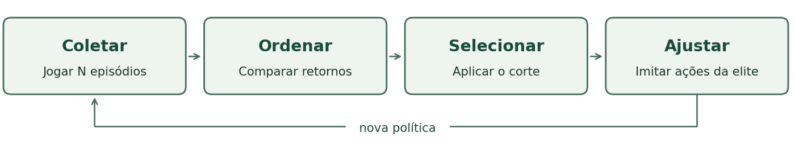
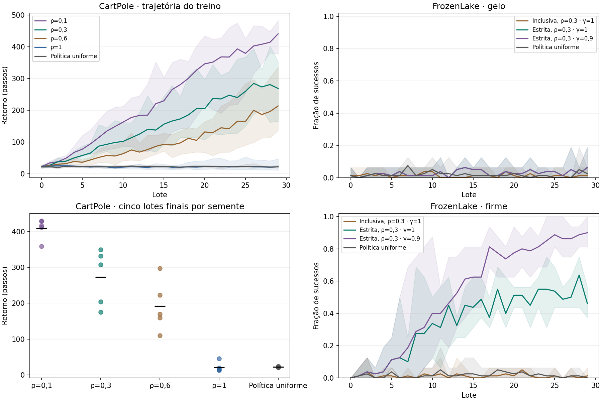
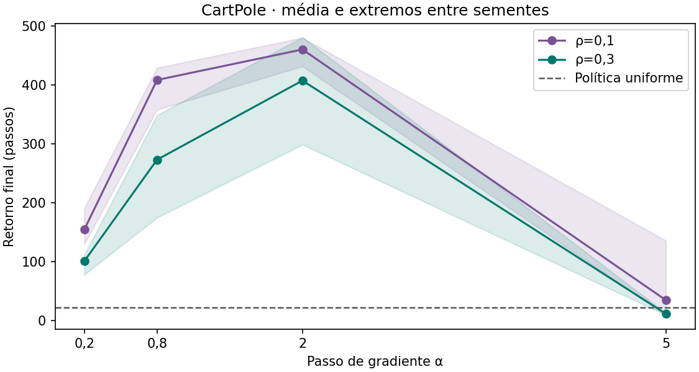

# Método da Entropia Cruzada (Cross-Entropy Method)

**Autoria:** Matheus Kennedy T. Santos · 2026.2 · Professor Glauber Rodrigues Leite · PPGI071 Aprendizado por Reforço (UFAL)

**Referências principais:** Maxim Lapan, *Deep Reinforcement Learning Hands-On* (2020, 2ª ed.); Richard S. Sutton e Andrew G. Barto, *Reinforcement Learning: An Introduction* (2018, 2ª ed.); de Boer et al., *A Tutorial on the Cross-Entropy Method* (2005). Os capítulos e as seções consultados são identificados pelo título nas citações e na bibliografia.

[Experimentos](https://metodo-da-entropia-cruzada.vercel.app/) · [Teoria](https://metodo-da-entropia-cruzada.vercel.app/teoria.html) · [Glossário](https://metodo-da-entropia-cruzada.vercel.app/glossario.html) · [Texto em PDF](site/dist/teoria.pdf) · [Fonte LaTeX](texto/teoria.tex) · [Reproduzir as medições](scripts/README.md)

<!-- teoria:inicio -->

## Motivação

Em CartPole, empurrar o carrinho rende um ponto por passo até a queda da haste ou o limite de tempo. Dois empurrões de mesma recompensa imediata podem iniciar partidas de dez ou duzentos passos. Em FrozenLake, percorrer a grade só rende um ponto ao alcançar a meta. Essas recompensas seguem as especificações dos ambientes (Farama Foundation, 2025). Como aprender com a partida completa?

O método da entropia cruzada (*Cross-Entropy Method*, CEM) repete decisões das melhores partidas. Cada observação guardada vira um exemplo de classificação, rotulado pela ação escolhida: **o CEM transforma o retorno de partidas inteiras em rótulos, e só aprende quando o retorno separa as boas partidas das ruins** (Lapan, 2020, *The cross-entropy method in practice* e *The cross-entropy method on FrozenLake*).

O bandit da aula 02 guarda uma média por ação, mas no carrinho a utilidade de um empurrão depende da posição, do ângulo da haste e das velocidades. A avaliação pela equação de Bellman da aula 03 exige probabilidades de transição; aqui o agente dispõe de amostras de um ambiente com estados contínuos (Leite, 2026, aulas 02–03).

Na notação da disciplina, o ciclo de Lapan (2020, *The cross-entropy method in practice*) se escreve assim. Os símbolos são definidos na próxima seção; aqui representam número de partidas, política, retorno, corte e fração guardada:

1.  Jogar $`N`$ partidas com $`\pi_\theta`$, guardando os pares $`(S_t,A_t)`$ e o retorno $`G_0`$ de cada uma.

2.  Escolher o corte $`c_k`$, o percentil $`100(1-\rho)`$ dos retornos.

3.  Manter as partidas com $`G_0\ge c_k`$.

4.  Ajustar $`\theta`$ para aumentar $`\ln\pi_\theta(A_t\mid S_t)`$ nos pares mantidos e voltar ao início.

<div class="center">



</div>

## Onde isto se encaixa

O agente observa $`S_t`$, escolhe $`A_t`$ e recebe $`R_{t+1}`$ junto de $`S_{t+1}`$. Um episódio é uma tentativa completa. A trajetória $`\tau`$ registra seus estados, ações e recompensas. A política $`\pi_\theta(a\mid s)`$ dá a probabilidade da ação $`a`$ no estado $`s`$ (Leite, 2026, aulas 01–03 e glossário).

O retorno soma as recompensas posteriores a uma decisão. O desconto $`\gamma`$ determina quanto pesa cada passo de espera. Por exemplo, se uma partida rende $`R_1=0`$, $`R_2=0`$ e $`R_3=1`$ e $`\gamma=0{,}9`$, o retorno a partir do início é $`0+0{,}9\cdot0+0{,}9^2\cdot1=0{,}81`$. O desempenho que interessa é a média dos retornos em novas partidas. Se $`T`$ é o número de transições e $`P_\theta`$ a distribuição das trajetórias sob a política, o objetivo episódico é
``` math
G_0=\sum_{t=0}^{T-1}\gamma^t R_{t+1},\qquad J(\theta)=\mathbb E_{\tau\sim P_\theta}[G_0(\tau)].
```
A esperança abrange o estado inicial, os sorteios da política e as respostas aleatórias do ambiente. A média dos retornos de um lote estima $`J`$ antes de qualquer seleção (Sutton e Barto, 2018, *Returns and Episodes*; *The Policy Gradient Theorem*).

### Da média de uma ação à política condicionada ao estado

As duas regras abaixo mostram o que muda do bandit da aula 02 para o CEM. A primeira corrige a média da ação $`a`$ a cada recompensa. A segunda escolhe os parâmetros $`\theta`$ que tornam mais prováveis os pares estado–ação da elite $`\mathcal D_k`$, contando repetições.
``` math
\begin{aligned}
 Q_{n+1}(a)&=Q_n(a)+\frac{1}{n}\big[R_n-Q_n(a)\big],\\
 \theta_{k+1}&\approx\arg\max_\theta\sum_{(s,a)\in\mathcal D_k}\ln\pi_\theta(a\mid s).
\end{aligned}
```
A aula 02 escreve $`Q_{k+1}=Q_k+\frac1k[R_k-Q_k]`$. Aqui se usa $`n`$ porque $`k`$ numera os lotes do CEM. $`R_n`$ é a $`n`$-ésima recompensa da ação $`a`$, recebida como $`R_{t+1}`$ no relógio do ambiente (Sutton e Barto, 2018, *Incremental Implementation*). Historicamente, porém, o CEM não veio dos bandits: surgiu na simulação de eventos raros (Rubinstein e Kroese, 2004, prefácio; de Boer et al., 2005, introdução).

<div class="center">

| Aspecto | Bandit da aula 02 | CEM episódico |
|:---|:---|:---|
| Representação | Média $`Q_n(a)`$ por ação | Distribuição $`\pi_\theta(a\mid s)`$ por estado |
| Alvo | Recompensa observada $`R_n`$ | Ação observada num episódio aceito |
| Unidade de dado | Uma recompensa | Trajetória filtrada pelo retorno |
| Exploração | Regra $`\varepsilon`$-gulosa sobre as médias | Sorteio da política estocástica |
| Origem dos dados | Política em vigor | Política em vigor na versão básica |

</div>

Lapan (2020, *The taxonomy of RL methods*) classifica o CEM como sem modelo (aprende com amostras), baseado em política (ajusta diretamente as escolhas) e *on-policy* (cada lote vem da política atual). Na terminologia de Sutton e Barto (2018, *Returns and Episodes*, *Policy Evaluation (Prediction)* e *Monte Carlo Control*), a tarefa é *episódica*, porque cada partida termina, e de *controle*, porque a política muda para obter mais retorno; na *predição*, ao contrário, apenas se avaliaria uma política fixa. Quanto à representação, o lago é *tabular*: cada casa tem sua própria linha de pesos. Como os estados do carrinho são contínuos, ele usa *aproximação de funções*: todos os estados compartilham os mesmos parâmetros (Sutton e Barto, 2018, *Policy Approximation and its Advantages*).

O método supõe as hipóteses abaixo. Cada item diz o que acontece quando ela falha.

- **Estado de Markov.** Se a observação omite algo relevante, uma política sem memória confunde situações que pedem decisões diferentes.

- **Estacionariedade.** Se transições ou recompensas mudam, decisões que deram certo podem deixar de servir.

- **Fim observável.** Sem fim de partida, não há retorno completo para ordenar.

- **Variação dos retornos.** Se todos empatam, a regra inclusiva conserva todos e a estrita descarta todos.

- **Amostragem finita.** A média pode cair no lote seguinte mesmo após um ajuste correto (Lapan, 2020, *The cross-entropy method on CartPole*).

### Correspondência dos símbolos

A tabela serve de consulta; os símbolos são definidos ao longo do texto.

<div class="center">

| Fonte | Nesta aula | Leitura |
|:---|:---|:---|
| Lapan, ciclo do agente | $`o_i,a_i,r_i \leftrightarrow S_t,A_t,R_{t+1}`$ | A recompensa chega após a ação do mesmo índice no livro |
| Lapan, coleta | $`z\leftrightarrow\tau`$, $`R(z)\leftrightarrow G_0`$, $`i\leftrightarrow k`$, $`\psi_i\leftrightarrow c_k`$ | Episódio, retorno, iteração e corte |
| Lapan, fundamentação | $`x,p(x),q(x)`$ | Candidato e distribuições. Na adaptação episódica usam-se $`\tau,P_\theta,q`$ |
| de Boer et al. | $`S(x),f(\cdot;v),W`$ | Escore $`G_0`$, família $`P_\theta`$ e razão $`P/q`$ |
| Sutton e Barto, política softmax | $`\pi(a\mid s,\theta)=\pi_\theta(a\mid s)`$ | Política parametrizada, com preferência $`h(s,a,\theta)`$ |
| Código | `theta, alpha, rho` | Pesos $`\theta`$, taxa $`\alpha`$, fração $`\rho`$. Na atualização suavizada de de Boer et al., $`\alpha`$ suaviza parâmetros |
| Código | `G0, R_proximo, corte` | Retorno, recompensa $`R_{t+1}`$ e limiar $`c_k`$ |
| Código | `elite, passos, lote` | Episódios aceitos $`\mathcal E_k`$, passos $`n_g`$ e episódios por lote $`N`$ |

</div>

## O método

### A ideia e um jogo de um passo

No jogo de um passo, o estado é único, a ação é esquerda (E) ou direita (D) e a pontuação é aleatória. Cada coluna representa uma partida independente. Neste lote ilustrativo, D rende tanto zero quanto seis pontos.

<div class="center">

| Episódio |  1  |  2  |  3  |  4  |  5  |  6  |  7  |  8  |  9  | 10  |
|:---------|:---:|:---:|:---:|:---:|:---:|:---:|:---:|:---:|:---:|:---:|
| Ação     |  E  |  D  |  E  |  D  |  E  |  D  |  E  |  D  |  E  |  D  |
| Retorno  |  0  |  0  |  1  |  1  |  2  |  2  |  3  |  4  |  5  |  6  |

</div>

Para guardar cerca de 30% das partidas ($`\rho=0{,}3`$), usa-se o percentil 70, valor abaixo do qual ficam cerca de 70% dos retornos. Com os retornos em ordem crescente, ele ocupa a posição $`0{,}7(10-1)=6{,}3`$, contando de zero, isto é, entre o 7.º valor (3) e o 8.º (4). Interpolando, como faz `numpy.percentile` por padrão (NumPy, 2025), o corte vale $`3+0{,}3\cdot(4-3)=3{,}3`$. Passam as partidas de retornos 4, 5 e 6, com ações D, E e D (Lapan, 2020, *The cross-entropy method on CartPole*, função `filter_batch`). [Explorar o corte](https://metodo-da-entropia-cruzada.vercel.app/selecao.html).

A verossimilhança é a probabilidade dos dados observados como função dos parâmetros. Com $`u=\pi(D)`$, reproduzir a elite D, E, D tem probabilidade $`u\cdot(1-u)\cdot u`$. Logo, a verossimilhança é $`\Lambda(u)=u^2(1-u)`$. O logaritmo preserva o ponto máximo e transforma o produto em soma. A derivada do logaritmo se anula em $`u=2/3`$ e a segunda derivada é negativa:
``` math
\ell(u)=2\ln u+\ln(1-u),\qquad \ell'(u)=\frac2u-\frac1{1-u}.
```
O máximo $`u=2/3`$ copia a frequência de D na elite. Trocar o sinal permite minimizar uma perda; dividir por três dá a perda por decisão. Agrupando ações pela frequência $`f`$ da elite, obtém-se a entropia cruzada
``` math
H(f,\pi)=-\sum_a f(a)\ln\pi(a)=-\tfrac23\ln u-\tfrac13\ln(1-u).
```

A tabela permite verificar se imitar a elite maximiza o retorno estimado. D rende em média $`13/5=2{,}6`$ e E, $`11/5=2{,}2`$. Logo, o retorno estimado $`2{,}6u+2{,}2(1-u)`$ cresce até $`u=1`$, enquanto a imitação escolhe $`u=2/3`$. Portanto, o CEM imita a elite; ele não escolhe a política de maior retorno estimado. Repetir a coleta e a seleção pode elevar os retornos e o corte; não há melhora garantida a cada lote.

### Formalização do ajuste da política

Seja $`\mathcal E_k`$ o conjunto de índices aceitos, $`T_i`$ a duração do episódio $`i`$ e $`M=\sum_{i\in\mathcal E_k}T_i`$ a quantidade de decisões aceitas. Generalizando a perda do jogo para todos os pares estado–ação aceitos, define-se, para $`M>0`$:
``` math
L_k(\theta)=-\frac1M\sum_{i\in\mathcal E_k}\sum_{t=0}^{T_i-1}
       \ln\pi_\theta(a_{it}\mid s_{it}).
```
A perda mede quão improváveis são as ações aceitas sob a política atual.

Uma tabela exata para estados contínuos precisaria de infinitas linhas. Uma função com pesos compartilhados responde também a observações novas. A rede do exemplo CartPole de Lapan (2020, *The cross-entropy method on CartPole*) usa 128 unidades ocultas com ativação $`\operatorname{ReLU}(x)=\max(0,x)`$. A saída atribui a cada ação uma preferência $`h_b=h(s,b,\theta)`$. A softmax normaliza preferências exponenciadas. Escrevendo a perda do rótulo $`a`$ como $`-h_a+\ln\sum_j e^{h_j}`$, obtém-se:
``` math
\pi_\theta(b\mid s)=\frac{e^{h_b}}{\sum_j e^{h_j}},\qquad
 \frac{\partial[-\ln\pi_\theta(a\mid s)]}{\partial h_b}
 =\pi_\theta(b\mid s)-\mathbf 1\{a=b\}.
```
No conjunto de decisões, o gradiente médio é probabilidade prevista menos frequência observada. Descer o gradiente aproxima essas distribuições. No mesmo jogo de um passo, considere agora uma elite de dez decisões: duas E e oito D, como na página Política. Com um parâmetro por ação e $`\alpha=0{,}5`$, um passo de descida produz:

<div class="center">

| Ação     | Logit inicial | Prob. inicial | Gradiente  | Novo logit  | Nova prob. |
|:---------|:-------------:|:-------------:|:----------:|:-----------:|:----------:|
| Esquerda |       0       |      0,5      | $`+0{,}3`$ | $`-0{,}15`$ |   0,426    |
| Direita  |       0       |      0,5      | $`-0{,}3`$ | $`+0{,}15`$ |   0,574    |

</div>

Para os pesos de uma rede, aplica-se também a regra da cadeia. O livro usa Adam com taxa 0,01 e a `CrossEntropyLoss` do PyTorch, que combina log-softmax e perda logarítmica; a softmax explícita só serve para sortear ações (Lapan, 2020, *The cross-entropy method on CartPole*; Sutton e Barto, 2018, *Policy Approximation and its Advantages*; PyTorch, 2025). [Testar um passo de gradiente](https://metodo-da-entropia-cruzada.vercel.app/politica.html).

### Aprofundamento opcional: da amostragem por importância à perda

Esta parte opcional explica o nome do método: aproximar a distribuição das trajetórias boas.

**1. Mudar a amostragem.** A mesma esperança pode ser estimada com outra distribuição. Se $`q`$ atribui probabilidade positiva onde $`P(\tau)F(\tau)`$ contribui para a média, a razão de densidades abaixo compensa a mudança de medida. Neste caso, a amostra é uma trajetória (de Boer et al., 2005, *A rare event simulation example*):
``` math
\mathbb E_P[F(\tau)]=\mathbb E_q\!\left[\frac{P(\tau)}{q(\tau)}F(\tau)\right].
```
**2. Aproximar a elite.** Escolha $`I_k(\tau)=\mathbf 1\{G_0(\tau)\geq c_k\}`$. Para limiar fixo e $`Z_k=\mathbb E_{P_{\theta_k}}[I_k]>0`$, a distribuição das trajetórias aceitas é $`\widetilde P_k=P_{\theta_k}I_k/Z_k`$. A divergência de Kullback–Leibler mede quanto uma distribuição candidata se afasta dessa referência. Expandir o logaritmo da razão dá
``` math
D_{\mathrm{KL}}(\widetilde P_k\Vert P_\theta)
 =\mathbb E_{\widetilde P_k}[\ln\widetilde P_k]-\mathbb E_{\widetilde P_k}[\ln P_\theta]
 =-H(\widetilde P_k)+H(\widetilde P_k,P_\theta).
```
O primeiro termo é o *negativo* da entropia da referência e fica constante durante o ajuste. O segundo é a entropia cruzada. Substituindo a distribuição condicionada, obtém-se
``` math
H(\widetilde P_k,P_\theta)=-\frac1{Z_k}\mathbb E_{P_{\theta_k}}[I_k\ln P_\theta].
```
Como $`Z_k`$ não depende do parâmetro em ajuste, o fator positivo $`1/Z_k`$ não muda o minimizador.

**3. Ajustar por verossimilhança.** Para a formulação geral, Lapan (2020, *The theoretical background of the cross-entropy method*) indica um livro que atribui a Kroese (a obra é de Rubinstein e Kroese, 2004) e o verbete de Kroese (2011). O lote é amostrado da política corrente, de modo que $`P/q=1`$ para essa coleta. Restringir a soma às trajetórias aceitas dá a máxima verossimilhança da elite (de Boer et al., 2005, *The CE-method for combinatorial optimization*).

Para $`T`$ passos, a regra do produto separa o estado inicial, as ações e as transições. Tomando logaritmos, obtém-se
``` math
\begin{aligned}
 \ln P_\theta(\tau)={}&\ln d_0(s_0)+\sum_{t=0}^{T-1}\ln\pi_\theta(a_t\mid s_t)\\
 &+\sum_{t=0}^{T-1}\ln p(s_{t+1},r_{t+1}\mid s_t,a_t).
\end{aligned}
```
Somente a parcela das ações depende de $`\theta`$. Substituir a esperança pela amostra e normalizar pelas $`M`$ decisões aceitas recupera a perda $`L_k`$ da formalização. De Boer et al. (2005, *Markovian decision process*) estimam, entre as trajetórias de elite que visitam o estado $`z`$, a fração que escolhe a ação $`a`$ nesse estado para o ajuste por máxima verossimilhança.

### Divergências entre as fontes

Na formulação de Lapan (2020, *The theoretical background of the cross-entropy method*), $`x`$ pode designar uma política candidata e $`\mathbb E_p[\ln p]`$ recebe o nome de entropia. Pela convenção $`H(p)=-\mathbb E_p[\ln p]`$, esse termo equivale a $`-H(p)`$. Para de Boer et al. (2005, *The CE method for rare event simulation*), $`x`$ é uma amostra genérica. Aqui, $`x`$ é a trajetória $`\tau`$.

De Boer et al. (2005, *A rare event simulation example* e *The CE method for rare event simulation*) tomam como limiar a estatística de ordem $`S_{(\lceil(1-\rho)N\rceil)}`$, isto é, o valor observado na posição $`\lceil(1-\rho)N\rceil`$ da amostra ordenada, sem interpolar. O teto $`\lceil x\rceil`$ arredonda $`x`$ para cima. Kroese (2011) usa outra convenção: $`N_e=\lceil\rho N\rceil`$ e limiar $`S_{(N-N_e+1)}`$. Quando $`\rho N`$ é inteiro, o limiar de Kroese fica uma posição acima; nos demais casos, os dois coincidem. Em ambos, empates no limiar podem ampliar a elite. De Boer et al. indicam frações tipicamente entre 0,01 e 0,1 (*A rare event simulation example*) e, na discussão sobre a escolha de $`\rho`$ (*The CE-method for combinatorial optimization*), $`\rho\approx0{,}01`$ para problemas de dimensão $`n\ge100`$ ou $`\rho\approx\ln(n)/n`$ para $`n<100`$; aqui, $`n`$ é o tamanho do problema e $`N`$, o do lote. No CartPole, Lapan (2020, *The cross-entropy method on CartPole*) chama `numpy.percentile`, cuja interpolação padrão é linear (NumPy, 2025), e usa $`\rho=0{,}3`$, uma fração bem maior.

Na descrição do ciclo, Lapan (2020, *The cross-entropy method in practice*) descarta apenas os episódios abaixo do limiar; os empates ficam. Em *The cross-entropy method on CartPole*, o texto fala em retorno superior ao limiar, mas a função `filter_batch` de [`01_cartpole.py`](https://github.com/PacktPublishing/Deep-Reinforcement-Learning-Hands-On-Second-Edition/blob/master/Chapter04/01_cartpole.py) também aceita empates. Só o lago modificado, em [`03_frozenlake_tweaked.py`](https://github.com/PacktPublishing/Deep-Reinforcement-Learning-Hands-On-Second-Edition/blob/master/Chapter04/03_frozenlake_tweaked.py), exige escore estritamente superior. A [implementação da terceira edição](https://github.com/PacktPublishing/Deep-Reinforcement-Learning-Hands-On-Third-Edition/tree/main/Chapter04) conserva as duas regras (Lapan, 2024, *The cross-entropy method on CartPole* e *The cross-entropy method on FrozenLake*).

## Pseudocódigo

As regras de corte seguem as funções `filter_batch` dos exemplos CartPole (inclusiva) e FrozenLake modificado (estrita) de Lapan (2020, *The cross-entropy method on CartPole* e *The cross-entropy method on FrozenLake*). Cada linha de $`X`$ contém os atributos do estado, e a linha correspondente de $`Y`$ indica a ação realizada.

> **CEM episódico com política softmax linear**
>
> **Parâmetros.** Fração $`\rho\in(0,1]`$, taxa $`\alpha>0`$, episódios por lote $`N`$, passos de gradiente $`n_g`$ e orçamento de lotes.
>
> **Inicialize** $`\theta\gets 0`$ (política uniforme).
>
> **Repita para cada lote $`k`$:**
>
> &emsp;&emsp;Para $`i=1,\ldots,N`$, gere uma trajetória sob $`\pi_\theta`$ e calcule $`G_i=\sum_{t=0}^{T_i-1}R_{t+1}^{(i)}`$.
>
> &emsp;&emsp;Use $`\widetilde G_i=G_i`$ como escore (no lago com desconto, $`\widetilde G_i=G_i\gamma^{T_i}`$).
>
> &emsp;&emsp;Calcule $`c_k`$, o quantil linear de ordem $`1-\rho`$ dos $`N`$ escores.
>
> &emsp;&emsp;Selecione $`\mathcal E_k=\{i:\widetilde G_i\ge c_k\}`$ (regra estrita: $`\widetilde G_i>c_k`$).
>
> &emsp;&emsp;Se $`\mathcal E_k`$ estiver vazio, passe ao próximo lote.
>
> &emsp;&emsp;Empilhe em $`X,Y`$ as $`M=\sum_{i\in\mathcal E_k}T_i`$ decisões aceitas.
>
> &emsp;&emsp;Repita $`n_g`$ vezes, com softmax por linha:
>
> &emsp;&emsp;&emsp;&emsp;$`P\gets\operatorname{softmax}(X\theta)`$.
>
> &emsp;&emsp;&emsp;&emsp;$`\theta\gets\theta-\alpha X^\top(P-Y)/M`$.

## Implementação

Em `scripts/cem.py`, cada função corresponde a um trecho do pseudocódigo: `coletar` gera as trajetórias, `selecionar` calcula o corte e escolhe a elite, e `ajustar` dá os $`n_g`$ passos de gradiente. Um episódio acaba por *término* (queda, buraco ou meta) ou por *truncamento* (limite de passos). A softmax subtrai o maior logit antes de exponenciar para evitar estouro numérico. A estrutura `Episodio` guarda atributos, ações e retorno `G0`. Oito passos aproximam o ajuste de máxima verossimilhança, sem buscar imitação completa da amostra; essa escolha é empírica. Aumentar $`N`$ tende a estabilizar o corte, mas custa mais episódios por atualização.

No carrinho, os atributos são posição dividida por 2,4, velocidade, ângulo dividido por 0,21, velocidade angular e uma constante 1 (intercepto). As divisões deixam as grandezas em escalas parecidas, de modo que um único passo $`\alpha`$ sirva para todas. No lago, um vetor indicador (*one-hot*) seleciona a linha de pesos da casa visitada.

A política linear deixa o gradiente visível em NumPy. O exemplo do livro e a configuração principal usam 16 episódios e percentil 70 (Lapan, 2020, *The cross-entropy method on CartPole*). A coleta usa Gymnasium (Towers et al., 2024).

<div class="center">

| Escolha | Lapan (2020, *The cross-entropy method on CartPole*) | Implementação deste material |
|:---|:---|:---|
| Política | Rede com 128 unidades ReLU | Softmax linear com atributos escalados |
| Ajuste por lote | PyTorch, um passo Adam a 0,01 | NumPy, oito passos a $`\alpha=0{,}8`$ |
| Parada | Retorno médio superior a 199 | Orçamento de 30 lotes |
| Ambiente | Gym, CartPole-v0, até 200 passos | Gymnasium 1.1.1, CartPole-v1, até 500 passos |

</div>

## Experimento: o que muda quando se retira a seleção?

### Previsão

O resíduo de uma decisão é a probabilidade prevista menos o rótulo: $`\pi_\theta(b\mid s)-\mathbf 1\{A=b\}`$, o gradiente da perda no logit da ação $`b`$. Sem seleção, toda decisão vira rótulo e, sob a política que a gerou, a esperança condicional vale
``` math
\mathbb E_{A\sim\pi_\theta(\cdot\mid s)}
 [\pi_\theta(b\mid s)-\mathbf 1\{A=b\}]=\pi_\theta(b\mid s)-\Pr(A=b\mid s)=0.
```
Assim, imitar as próprias decisões não fornece uma direção esperada de ajuste naquele estado. Por isso, treinar com $`\rho=1`$ deve dar desempenho próximo ao da política uniforme. A previsão vale também para o lago com regra inclusiva quando o corte é zero, porque então a elite é o lote inteiro. A conta vale decisão a decisão. No lote, a divisão pelo número aleatório de decisões $`M`$ e os passos repetidos sobre os mesmos dados podem produzir desvios, que aparecem como deriva entre sementes.

### Protocolo e resultados

Comparam-se: (1) no CartPole, retirar a seleção e variar $`\rho`$; (2) no lago, os cortes inclusivo e estrito, o deslizamento e o desconto; (3) no CartPole, variar $`\alpha`$. Em `scripts/experimento.py`, cada configuração usa 30 lotes de 16 episódios, totalizando 480 episódios por semente (17 a 21). Mede-se o retorno antes do ajuste. Resumem-se os cinco lotes finais por semente e, entre sementes, a média e os extremos. A política uniforme, sem treino, é a linha de base. [Curvas, tabelas e dados](https://metodo-da-entropia-cruzada.vercel.app/experimento.html).

<div class="center">

| CartPole                      | Passos em média | Faixa entre sementes |
|:------------------------------|----------------:|---------------------:|
| Política uniforme             |           22,59 |          21,18–24,45 |
| Treino com todos ($`\rho=1`$) |           22,04 |          12,90–45,74 |
| CEM ($`\rho=0{,}6`$)          |          192,17 |        110,44–297,50 |
| CEM ($`\rho=0{,}3`$)          |          273,37 |        174,95–349,14 |
| CEM ($`\rho=0{,}1`$)          |          408,73 |        358,21–429,46 |

</div>

Os valores foram obtidos em Windows; a reprodução em Linux está no `scripts/README.md`. Como previsto, treinar com todos os episódios manteve a média perto da política uniforme, e a seleção multiplicou a duração das partidas. Perto do fim, porém, muitas atingem o teto de 500 passos: o corte chegou a 500 em 61 de 150 lotes, e os empates deixaram passar até 14 episódios, sem distinguir as melhores.

No lago, comparam-se as regras a $`\rho=0{,}3`$, sem desconto. Cada célula conta sucessos nos 400 episódios finais de uma configuração.

<div class="center">

| FrozenLake        | Gelo escorregadio | Piso determinístico |
|:------------------|------------------:|--------------------:|
| Política uniforme |     6/400 (1,50%) |       3/400 (0,75%) |
| CEM inclusivo     |     4/400 (1,00%) |       3/400 (0,75%) |
| CEM estrito       |    15/400 (3,75%) |    210/400 (52,50%) |

</div>

Num lote típico do gelo, com quinze derrotas e uma vitória, o percentil 70 vale zero: a regra inclusiva deixa passar as dezesseis partidas, nesse corte, e repete a situação de $`\rho=1`$; a estrita imita só a vitória.

A regra estrita tem, porém, um ponto cego. Com $`N=16`$, o percentil 70 fica na posição $`0{,}7(16-1)=10{,}5`$: vale zero com até quatro vitórias, 0,5 com cinco e um com seis ou mais. Neste último caso nenhuma vitória supera o corte, e o lote não ensina nada. Isso explica 86 dos 109 lotes vazios no piso firme; os outros 23, e os 92 do gelo, não tiveram vitória. Esse bloqueio ajuda a explicar os 52,5% observados; o valor não é um teto matemático do método nem da regra.

Com $`\gamma=0{,}9`$, o escore $`R\gamma^T`$ desempata as vitórias pela duração: no piso firme, elas passaram de 210 para 352 em 400, e os lotes vazios caíram de 109 para 75. No gelo nada mudou: nenhum lote teve mais de três vitórias, o corte ficou em zero e toda vitória passou com ou sem desconto.

<figure data-latex-placement="H">

<figcaption>À esquerda, médias e extremos por lote no CartPole e médias finais de cada semente, com a média entre sementes marcada por um traço. À direita, médias por lote e faixas mínimo–máximo no FrozenLake, com e sem deslizamento. No gelo, as curvas estritas com <span class="math inline"><em>γ</em></span> igual a 1 e 0,9 coincidem.</figcaption>
</figure>

No CartPole, $`\rho=0{,}1`$ atingiu 460,59 passos com $`\alpha=2`$ e caiu para 34,65 com $`\alpha=5`$. Aumentar a taxa além do melhor valor testado piorou as duas curvas; com $`\alpha=5`$ e $`\rho=0{,}3`$, a média ficou abaixo da política uniforme (11,42 contra 22,59). Passos grandes podem concentrar cedo demais a política em escolhas ruins. [Resultados por configuração](https://metodo-da-entropia-cruzada.vercel.app/resumo.csv).

<figure data-latex-placement="H">

<figcaption>CartPole: retorno médio nos cinco lotes finais por taxa de aprendizagem. A faixa delimita os extremos entre sementes, e a linha tracejada marca a política uniforme.</figcaption>
</figure>

### O que o experimento mostra

Selecionar a elite melhorou o carrinho; aceitar todos preservou o desempenho da política uniforme. No lago, empates podem anular a seleção, e o desconto só ajuda quando altera a elite. A taxa de aprendizagem determina quanto a política imita essa amostra: aumentar o passo nem sempre melhora o resultado.

## Limites e continuidade

Os resultados concretizam as limitações discutidas por Lapan (2020, *The cross-entropy method on FrozenLake*). Esperar o fim custa até 500 transições por episódio no CartPole; o teto ainda empata partidas longas. No lago, retornos 0/1 pouco variados tornam o corte pouco informativo. Por fim, todas as decisões de uma partida aceita recebem o mesmo peso na perda, mesmo as que atrasaram a meta: o filtro não atribui crédito individual. A robustez mencionada por Lapan (2020, *The cross-entropy method in practice*) depende da configuração: a média do carrinho variou de 192,17 a 408,73 entre $`\rho=0{,}6`$ e $`\rho=0{,}1`$.

No lago, o escore $`R\gamma^T`$ favorece vitórias curtas (com $`\gamma=0{,}9`$, seis e dez passos valem 0,53 e 0,35), mas vitórias de mesma duração ainda empatam. A variante de Lapan (2020, *The cross-entropy method on FrozenLake*) também amplia o lote para 100 e reaproveita elites antigas; aqui só o escore muda.

Os métodos seguintes do curso atacam essas limitações. O Q-learning propaga valor a estados anteriores a partir de cada transição, sem esperar o fim da partida (Sutton e Barto, 2018, *Q-learning: Off-policy TD Control*). Na família baseada em política, o REINFORCE pesa cada escolha pelo retorno seguinte, em vez de um peso 0 ou 1 (Sutton e Barto, 2018, *REINFORCE: Monte Carlo Policy Gradient*).

## Referências

De Boer, P.-T., Kroese, D. P., Mannor, S. e Rubinstein, R. Y. (2005). *A Tutorial on the Cross-Entropy Method*. Annals of Operations Research, 134, 19–67. DOI 10.1007/s10479-005-5724-z. Seções *A rare event simulation example*, *The CE method for rare event simulation*, *The CE-method for combinatorial optimization*, *Markovian decision process*. [Texto integral](https://ris.utwente.nl/ws/portalfiles/portal/6700787/fulltext.pdf).

Farama Foundation (2025). *Gymnasium*, versão 1.1.1 utilizada no experimento. Dinâmica, recompensa e limites dos ambientes. [CartPole](https://gymnasium.farama.org/environments/classic_control/cart_pole/); [FrozenLake](https://gymnasium.farama.org/environments/toy_text/frozen_lake/).

Kroese, D. P. (2011). *Cross-Entropy Method*. Wiley Encyclopedia of Operations Research and Management Science. [DOI](https://doi.org/10.1002/9780470400531.eorms0210). [PDF do autor](https://people.smp.uq.edu.au/DirkKroese/ps/eormsCE.pdf).

Lapan, M. (2020). *Deep Reinforcement Learning Hands-On*, 2ª ed. Packt. Capítulo *The Cross-Entropy Method*: seções *The taxonomy of RL methods*, *The cross-entropy method in practice*, *The cross-entropy method on CartPole*, *The cross-entropy method on FrozenLake*, *The theoretical background of the cross-entropy method*. [Livro](https://www.packtpub.com/en-us/product/deep-reinforcement-learning-hands-on-9781838826994); [implementações do autor](https://github.com/PacktPublishing/Deep-Reinforcement-Learning-Hands-On-Second-Edition/tree/master/Chapter04).

Lapan, M. (2024). *Deep Reinforcement Learning Hands-On*, 3ª ed. Packt. ISBN 978-1-83588-270-2. Capítulo *The Cross-Entropy Method*: seções *The cross-entropy method on CartPole* e *The cross-entropy method on FrozenLake*. [Código em Gymnasium](https://github.com/PacktPublishing/Deep-Reinforcement-Learning-Hands-On-Third-Edition/tree/main/Chapter04).

Leite, G. R. (2026). *Curso de Aprendizado por Reforço*. PPGI071, UFAL. Acesso em 17 nov. 2026. [Glossário da disciplina](https://github.com/glauberrleite/curso-aprendizado-por-reforco); [interação](https://github.com/glauberrleite/curso-aprendizado-por-reforco/tree/main/01-introducao); [bandits](https://github.com/glauberrleite/curso-aprendizado-por-reforco/tree/main/02-multi-armed-bandit); [processos de decisão de Markov](https://github.com/glauberrleite/curso-aprendizado-por-reforco/tree/main/03-markov-decision-processes).

NumPy (2025). *numpy.percentile*, documentação da versão 2.2, método `linear`. [Documentação](https://numpy.org/doc/2.2/reference/generated/numpy.percentile.html).

PyTorch (2025). *CrossEntropyLoss*, documentação da versão 2.9, caso de índices de classe. [Documentação](https://docs.pytorch.org/docs/2.9/generated/torch.nn.CrossEntropyLoss.html).

Rubinstein, R. Y. e Kroese, D. P. (2004). *The Cross-Entropy Method: A Unified Approach to Combinatorial Optimization, Monte-Carlo Simulation, and Machine Learning*. Springer. Prefácio. [Livro](https://doi.org/10.1007/978-1-4757-4321-0).

Sutton, R. S. e Barto, A. G. (2018). *Reinforcement Learning: An Introduction*, 2ª ed. MIT Press. Capítulos e seções consultados: *Multi-armed Bandits* (*Incremental Implementation*); *Finite Markov Decision Processes* (*Returns and Episodes*); *Dynamic Programming* (*Policy Evaluation (Prediction)*); *Monte Carlo Methods* (*Monte Carlo Control*); *Temporal-Difference Learning* (*Q-learning: Off-policy TD Control*); *Policy Gradient Methods* (*Policy Approximation and its Advantages*; *The Policy Gradient Theorem*; *REINFORCE: Monte Carlo Policy Gradient*). [Livro](http://incompleteideas.net/book/the-book-2nd.html).

Towers, M. et al. (2024). *Gymnasium: A Standard Interface for Reinforcement Learning Environments*. [arXiv:2407.17032](https://arxiv.org/abs/2407.17032).

<!-- teoria:fim -->

## Estrutura do repositório

O README é a entrega principal. A pasta `scripts/` contém o método e a reprodução do estudo. Em `media/` ficam as medições e figuras. A fonte do texto (`teoria.tex`) e o compilador do site e do README estão em `texto/`. O site reúne os textos LaTeX em `site/textos/` e os arquivos publicados em `site/dist/`.

**Uso de IA generativa.** O autor usou o Codex e o Claude para montar o site e para ligar suas anotações do capítulo numa linha lógica de raciocínio sobre o problema. O Claude também apoiou a revisão do texto, das referências e do site. A responsabilidade pelo material apresentado é do autor.
